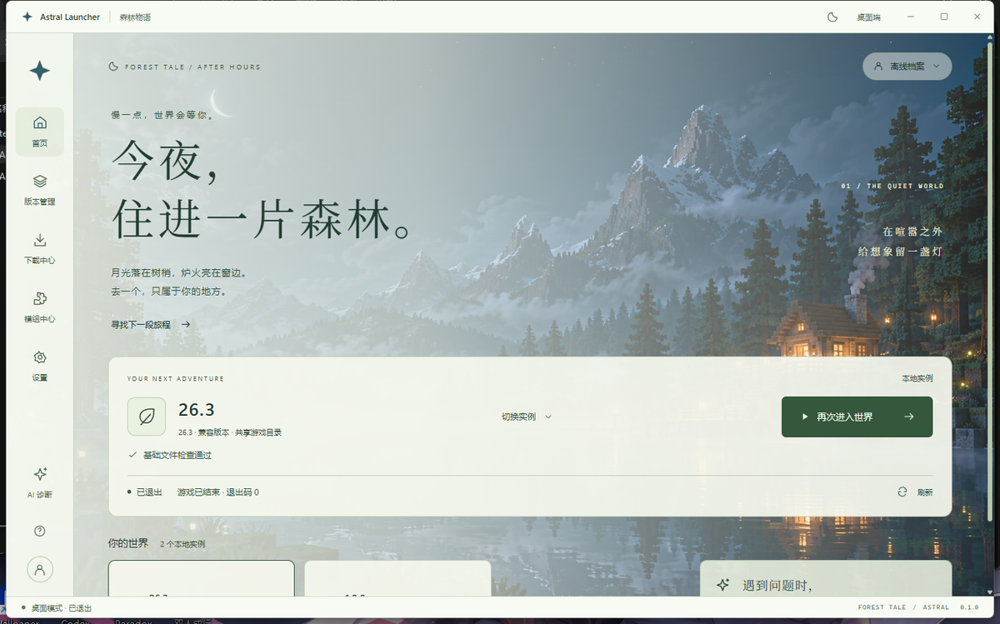

# Astral Launcher

一个 Windows 上的 Minecraft 启动器。界面是「森林物语 · 萤火夜航」，核心支持国内镜像、实例隔离与四类加载器。

> 当前进度：**V2 后端**（`feature/astral-v2-core`）—— 安装计划、四类加载器（Fabric / Quilt /
> Forge / NeoForge）全部**真机实测**安装与启动；资源安装、依赖、整合包、Java、日志诊断均已落地。
> 微软登录仍缺 Azure 应用，AI 分析未接。



更多截图：[版本管理](shots/ui-versions.png) · [下载中心](shots/ui-download.png) · [模组中心](shots/ui-mods.png) · [设置](shots/ui-settings.png)

> 以上为本机真实运行截图（Windows 11，读取本机 `.minecraft` 中的 1.8.9 与 26.3）。

## 已实现

| 能力 | 状态 | 说明 |
|---|---|---|
| 版本清单 | ✅ | Mojang 官方 / BMCLAPI 镜像，920 个版本 |
| 安装 | ✅ | 两段式计划（准备 → 执行），失败回滚；缺 Java 自动准备 |
| 启动 | ✅ | 离线登录；四类加载器均实测进主菜单 |
| 实例 | ✅ | 托管实例独立 `mods/config/saves/logs`；兼容实例标注共享目录 |
| 会话 | ✅ | `GameSession` 记录 pid，重启按 pid 对账；退出码未知 ≠ 崩溃 |
| 任务 | ✅ | revision 单调、终态粘滞、真取消（两阶段）、跨重启 `INTERRUPTED`、去重、重试、稳定 `phase` |
| 加载器 | ✅ | Fabric / Quilt / Forge / NeoForge 安装 + 启动**全部实测** |
| 资源安装 | ✅ | Mod / 资源包 / 光影包 / 数据包，目标目录由 Rust 解析 |
| 依赖 | ✅ | 自动补必需依赖，找不到则明确报错 |
| 模组更新 | ✅ | 按 SHA1 反查，原子替换（先新后旧） |
| 整合包 | ✅ | `.mrpack` 安装与导出，均实测 |
| Java | ✅ | 扫描本机 + Adoptium 自动下载 + 按版本推荐 |
| 光影组件 | ✅ | Iris / Oculus 可用性判断；OptiFine 明确不可自动安装 |
| 日志诊断 | ✅ | 读取 + 本机脱敏预览（不上传） |
| 国内镜像 | ✅ | BMCLAPI 改写依赖库与资源 |
| AI 崩溃分析 | ❌ | 未接 DeepSeek（需用户 Key + 上传确认流程） |
| 微软登录 | ❌ | 缺 Azure 应用 ID；令牌需 DPAPI 加密 |

## 结构

```
app/                       Tauri 2 + React 19 + TS + Rust
  src/                     界面：pages / components / styles（森林物语主题）
  src-tauri/src/
    core.rs                安装、启动、加载器装配（基于 portablemc）
    instance.rs            实例模型、目录、健康检查
    session.rs             游戏会话与 pid 对账
    task.rs                任务注册表（取消 / 持久化 / phase / 重试）
    plan.rs                两段式安装计划
    resources.rs           Modrinth 资源查询与定向安装
    modpack.rs             .mrpack 解析、安装、导出
    updates.rs             模组更新检查与原子替换
    jdk.rs / java.rs       JDK 下载与 Java 探测
    logs.rs                日志读取与脱敏
    components.rs          光影支持组件目录
    net.rs                 白名单、原子下载、哈希校验
    loader.rs / mods.rs    加载器目录、模组文件管理
    stats.rs / worlds.rs   存档与统计
```

## 开发

```powershell
cd app
pnpm install
pnpm dev            # 只看界面，不需要 Rust
pnpm tauri dev      # 原生窗口
pnpm tauri build    # 出 exe
```

前提：Node 18+、Rust stable（MSVC toolchain）、WebView2。

### 测试

```powershell
# 无界面自检（当前 93 项，输出 log + json）
.\astral.exe --selftest

# 单元测试（46 项，release 构建后复制到仓库外运行）
# pwsh -NoProfile -File scripts/run-tests.ps1

# 命令注册表校验（防止写了命令忘记注册）
pwsh -NoProfile -ExecutionPolicy Bypass -File scripts/check-commands.ps1
```

> `cargo test` 在本机因测试二进制加载失败（0xC0000139）不可用，
> 详见 [`docs/v2/10-cargo-test-调查.md`](docs/v2/10-cargo-test-调查.md)。

## 配置

`%APPDATA%\Astral\config.json`（原子写 + `.bak`）

```jsonc
{
  "gameDir": "C:\\Users\\你\\AppData\\Roaming\\.minecraft",
  "source": "official",          // official | bmclapi
  "username": "Player",
  "activeInstanceId": null,
  "msaClientId": null            // 可选：你自己的 Azure 应用 ID
}
```

## 文档

| 文档 | 内容 |
|---|---|
| [api-contract.md](docs/api-contract.md) | 接口契约 v4（v1–v3.3 保留） |
| [api-contract-bridge-v2.md](docs/api-contract-bridge-v2.md) | V2 新命令的 TS 包装与接入规则 |
| [docs/v2/09](docs/v2/09-V2-总览与验收状态.md) | 54 个命令的当前状态 |
| [docs/v2/12](docs/v2/12-验收报告.md) | 验收报告：证据、未验证项、复现命令 |
| [docs/v2/11](docs/v2/11-合并预演.md) | 合并预演（零冲突） |

## 合规

- 不包含、不分发任何 Minecraft 游戏文件；内容由用户自己的账号从官方渠道获取。
- 国内镜像只做**透明加速**（改地址），不替换内容、不做二次分发。
- 与 Mojang、Microsoft、网易均无关联。

## 许可证

本项目代码 [MIT](LICENSE)。第三方组件见 [THIRD_PARTY.md](THIRD_PARTY.md)（`portablemc` 为 Apache-2.0）。
