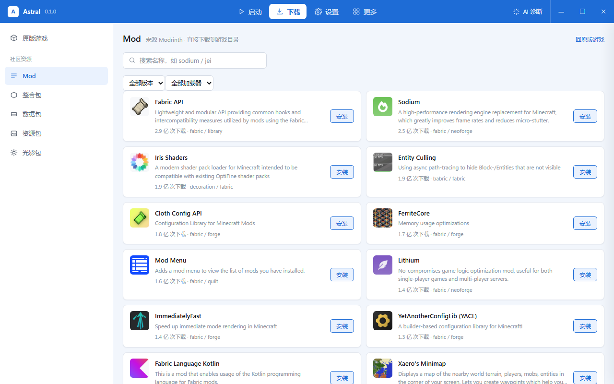

# W3：启动打通 + 国内源 + 资源下载

> 2026-10-22 · 能装、能启、能换源、能下 Mod

## 1. 启动（真跑起来了）

`core::launch` = 装（缺就补）+ 起进程，返回 PID。左栏「启动游戏」直接调它，
进度事件和安装共用一条 `astral://progress`。

验证（`launch_b1_7_3` 测试，真机真 Java）：

```
✓ 已启动 PID 2168，准备用 860.1494ms
16 achievements
151 recipes
Setting gameDir to: ...\astral-mc-test
Starting up SoundSystem...
Initializing LWJGL OpenAL
OpenAL initialized.

javaw.exe   2168   409,448 K      ← 12 秒后仍然活着
```

从点击到窗口出现约 **860 ms**（不含下载）。测试跑完自动 kill，不会留进程。

## 2. 配置（`%APPDATA%\Astral\config.json`）

```jsonc
{
  "gameDir": "C:\\Users\\你\\AppData\\Roaming\\.minecraft",
  "source": "official",   // official | bmclapi
  "username": "Player"
}
```

设置页可改：**下载源**、**游戏目录**（带「打开」按钮）、**离线用户名**。
改完即时落盘，下次安装/启动直接生效。

左栏版本下拉从 `scan_installed()` 读，点一下就能切换要启动的版本。

## 3. 国内源（BMCLAPI）

### 怎么做的

`portablemc` 的下载地址是 `pub(crate) const` 硬编码的，没法从外面改。所以把 crate
**vendor 进仓库**（`src-tauri/vendor/portablemc`，Apache-2.0 允许），打三个补丁：

| 文件 | 补丁 |
|---|---|
| `src/mirror.rs` | 新增：地址改写表 + 全局开关 |
| `src/download.rs` `Entry::new` | 所有下载项创建时过一遍 `mirror::map()` |
| `src/download.rs` `Batch::download` | 镜像模式下并发 40 → **6** |

改写规则：

```
https://libraries.minecraft.net/{path}
  → https://bmclapi2.bangbang93.com/maven/{path}

https://resources.download.minecraft.net/{2}/{hash}
  → https://bmclapi2.bangbang93.com/assets/{2}/{hash}

.../mc/game/version_manifest_v2.json
  → https://bmclapi2.bangbang93.com/mc/game/version_manifest_v2.json
```

**为什么并发要降**：第一次跑镜像安装失败，27 个资源请求报 `reqwest::Error{kind:Request}`。
查下来是下载器默认 40 路并发，BMCLAPI 会直接重置连接。降到 6 之后一次通过。

### 验证

```
单一文件探测：
✓ 122176 bytes  <- https://bmclapi2.bangbang93.com/maven/org/ow2/asm/asm/9.3/asm-9.3.jar
✓ 2959479 bytes <- https://bmclapi2.bangbang93.com/maven/com/google/guava/.../guava-31.1-jre.jar
✓ 9101 bytes    <- https://bmclapi2.bangbang93.com/assets/b6/b62ca8ec...e3356

整版本安装（b1.7.3，全新目录）：
✓ 镜像安装用时 4.9s
```

### 没覆盖到的

- **客户端 jar**（`piston-data.mojang.com`）——BMCLAPI 只有 `/version/{版本}/client` 这种带版本号的路径，
  而下载项里只有 SHA1，没有版本号，无法通用改写。约 20~30 MB/版本。
- **Java 运行时**（Mojang 官方 JRE，约 180 MB）——镜像不提供。

也就是说镜像覆盖的是**文件数量的大头**（依赖库 + 资源，几百到上千个小文件），
剩下的两个大文件仍走官方。要彻底镜像，得把版本 JSON 里 `downloads.client.url` 也改写掉——W4 可以做。

## 4. 资源下载（Modrinth）

搜索结果直接在前端 `fetch`（Modrinth 的接口带 `Access-Control-Allow-Origin: *`，不需要后端代理），
下载走 Rust：`download_to(url, kind, filename)` 按类型落到对应目录。

| 侧栏 | 落盘目录 | Modrinth project_type |
|---|---|---|
| Mod | `mods/` | mod |
| 整合包 | `modpacks/` | modpack |
| 数据包 | `datapacks/` | datapack |
| 资源包 | `resourcepacks/` | resourcepack |
| 光影包 | `shaderpacks/` | shader |

界面上有：关键词搜索、版本筛选、加载器筛选（Mod/整合包）、下载量、分类标签、安装进度的百分比。



## 5. 已知缺口

- **整合包只下了 `.mrpack` 文件，没有解包安装**（要解析 mrpack 的 modrinth.index.json → 建实例 → 拉依赖）。
  目前点「安装」会下载到 `modpacks/` 但不会生成实例。
- 没有「装到哪个版本」的概念——现在只有全局 `mods/`，没有按实例隔离。
- 客户端 jar / JVM 未镜像。
- 微软登录还没接（`portablemc::msa` 可用）。

## 6. 下一步（W4）

1. **实例化**：每个版本一套 `versions/{name}/` + 独立 mods，资源下载选目标实例
2. **整合包安装**：解析 mrpack / CurseForge zip，建实例 + 拉依赖 + 还原 overrides
3. **客户端 jar 也走镜像**：在 `moj` 里拿到版本号后改写 `downloads.client.url`
4. 微软登录（设备码）
